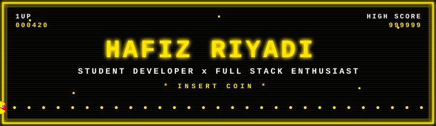

<div align="center">



<a href="https://github.com/hrdy-oss">
  
</a>


</div>


##   About Me

-  **Student Developer & Full Stack Enthusiast** dari **SMK N 1 Adiwerna** / *Vocational student who loves building things for the web*
-  Currently building: **[remindercloud](https://reminder.freedev.app/index.php?p=masuk)**

-  Currently learning: *Laravel, Docker, AWS, IoT*
- 🐧 Suka utak-atik **Linux** (Arch · CachyOS · Ubuntu · Red Hat) / *Linux tinkerer*
- Hobi eksperimen **Arduino UNO & IoT** / *Arduino & IoT experiments*
- 💬 Ngobrol soal web, server, atau IoT? **Chat aja!** / *Let's talk web, servers, or IoT!*


##  Tech Stack

<a href="https://developer.android.com" target="_blank" rel="noreferrer">  </a> <a href="https://www.arduino.cc/" target="_blank" rel="noreferrer">  </a> <a href="https://aws.amazon.com" target="_blank" rel="noreferrer">  </a> <a href="https://www.w3schools.com/css/" target="_blank" rel="noreferrer">  </a> <a href="https://www.docker.com/" target="_blank" rel="noreferrer">  </a> <a href="https://www.figma.com/" target="_blank" rel="noreferrer">  </a> <a href="https://cloud.google.com" target="_blank" rel="noreferrer">  </a> <a href="https://git-scm.com/" target="_blank" rel="noreferrer">  </a> <a href="https://developer.mozilla.org/en-US/docs/Web/JavaScript" target="_blank" rel="noreferrer">  </a> <a href="https://www.linux.org/" target="_blank" rel="noreferrer">  </a> <a href="https://mariadb.org/" target="_blank" rel="noreferrer">  </a> <a href="https://www.mysql.com/" target="_blank" rel="noreferrer">  </a> <a href="https://www.nginx.com" target="_blank" rel="noreferrer">  </a> <a href="https://nodejs.org" target="_blank" rel="noreferrer">  </a> <a href="https://www.php.net" target="_blank" rel="noreferrer">  </a> <a href="https://www.python.org" target="_blank" rel="noreferrer">  </a> <a href="https://reactjs.org/" target="_blank" rel="noreferrer">  </a> <a href="https://www.typescriptlang.org/" target="_blank" rel="noreferrer">  </a> <a href="https://vuejs.org/" target="_blank" rel="noreferrer">  </a> </p>


## 📊 GitHub Stats

<div align="center">


</div>


## 🚀 Proyek Unggulan / Featured Projects

<!-- Ganti REPO_NAME_1 dan REPO_NAME_2 dengan nama repo kamu / Replace with your repo names -->
<div align="center">

<a href="https://github.com/hrdy-oss/remindercloud">
  
</a>
&nbsp;&nbsp;&nbsp;&nbsp;
<a href="https://github.com/hrdy-oss/thrifting">
  
</a>

</div>


## 🟡 Kontribusi / Contributions

<p align="center">
  <strong>Pac-Man</strong><br>
<picture>
  <source media="(prefers-color-scheme: dark)" srcset="https://raw.githubusercontent.com/hrdy-oss/hrdy-oss/output/pacman-contribution-graph-dark.svg">
  
</picture>
  <br><br>
  <strong>Snake</strong><br>
<picture>
  <source media="(prefers-color-scheme: dark)" srcset="https://raw.githubusercontent.com/hrdy-oss/hrdy-oss/output/github-snake-dark.svg">
  
</picture>
</p>


## Let's Connect

<div align="center">

<div align="center">

<a href="https://www.instagram.com/_hafzhryd/">
  
</a>

<a href="https://www.linkedin.com/in/hafiz-akmal-riyadi-a35b19435/">
  
</a>

</div>
```text
★ ★ ★  GAME OVER? NO WAY. PRESS START TO CONTINUE  ★ ★ ★
```

Dibuat dengan 💛 dan palet **Pac-Man Yellow x Black**

</div>
